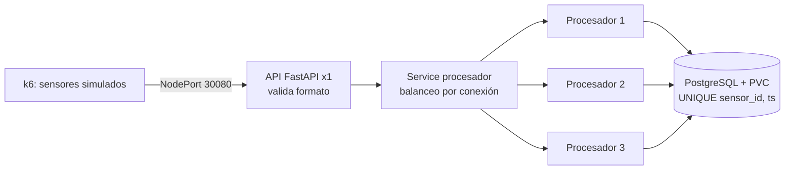

# Diseño y arquitectura

## 1. Objetivo
Implementar y evaluar un sistema distribuido de ingesta de telemetría IoT en Docker + Minikube: rendimiento,
escalabilidad, recuperación ante fallos del procesador e integridad bajo concurrencia.

## 2. Componentes
| Componente | Tecnología | Responsabilidad |
|---|---|---|
| API | FastAPI | Valida **formato** (tipos, `sensor_id`, fecha con zona horaria) y reenvía. |
| Procesador (1–3 réplicas) | FastAPI + psycopg | Valida **rangos físicos**, calcula promedio móvil y z-score, decide alertas, guarda todo en una transacción. |
| Base de datos | PostgreSQL 16 + PVC | Persistencia y reglas de integridad. |
| Carga | k6 | Simula cientos de sensores (`SENSORES=200`), con ~2 % de lecturas críticas y ~2 % de picos anómalos. |
| Métricas | k6, `kubectl top` (metrics-server) | Latencia, solicitudes/s, errores, CPU y memoria. |

## 3. API
| Método y ruta | Descripción |
|---|---|
| `POST /api/v1/lecturas` | `{"sensor_id","ts","temperatura","consumo_w"}` → **201** nueva, **200** reintento idempotente, **409** mismo `(sensor_id, ts)` con otros valores, **422** formato/rango inválido, **503** componente caído. |
| `GET /api/v1/alertas?sensor_id=&severidad=&limite=` | Últimas alertas. |
| `GET /api/v1/sensores/{id}/lecturas` | Últimas lecturas con promedio móvil y z-score. |
| `GET /api/v1/estadisticas` | Totales de lecturas, sensores y alertas. |
| `GET /health/live`, `/health/ready` | Probes de Kubernetes. |

## 4. Reglas de negocio (`shared/analitica.py`)
- Rangos válidos: temperatura −40…125 °C, consumo 0…10 000 W (fuera → 422).
- **Promedio móvil:** media de las últimas 10 temperaturas del sensor, incluyendo la actual.
- **Z-score:** `(t − media_previas) / max(desv_previas, 0.5)`, solo con ≥ 5 lecturas previas.
- **CRITICA:** temperatura ≥ 85 °C **o** consumo ≥ 4000 W. **ADVERTENCIA:** |z| ≥ 3.

## 5. Integridad (prueba E5)
1. `UNIQUE (sensor_id, ts)` en `lecturas` + `INSERT … ON CONFLICT DO NOTHING`: un reintento nunca duplica.
2. Lectura y alerta en **una transacción**; FK de `alertas` a `lecturas`: no hay alertas huérfanas ni lecturas críticas sin alerta.
3. La respuesta 200/201 se envía **después del COMMIT**. Si el pod muere antes, no hay confirmación → el cliente reintenta con el mismo `(sensor_id, ts)`.
4. Métricas de E5: `perdidas = confirmadas − en_BD` (lecturas y alertas críticas), `duplicados`, `lecturas_con_alerta_faltante`. Todas deben ser **0**.

## 6. Hipótesis
- **H1:** más réplicas del procesador aumentan solicitudes/s mientras el procesador sea el límite (cada pod tiene tope de 0.5 CPU).
- **H2:** al subir los clientes simultáneos crecen p95 y errores por saturación.
- **H3:** al eliminar un pod, Kubernetes lo recrea; con 2 réplicas el servicio sigue atendiendo, con algunos errores durante la caída.
- **H4:** ninguna lectura ni alerta confirmada se pierde tras eliminar/reiniciar procesadores ni tras reiniciar PostgreSQL (PVC).
- **H5:** muchas solicitudes simultáneas con el mismo `(sensor_id, ts)` producen **una** fila y **una** alerta.
- **H6 (a contrastar):** con 3 réplicas el rendimiento puede no mejorar frente a 2: el clúster, k6, la API y el `fsync` de PostgreSQL comparten el mismo equipo.

## 7. Decisiones de diseño (justificarlas en la defensa)
| Decisión | Motivo |
|---|---|
| Service **NodePort** (no `port-forward`) | `port-forward` fija la conexión a un solo pod y arruinaría E2. |
| API **sin keep-alive** hacia el procesador (`HTTP_KEEPALIVE=0`) | Kubernetes balancea por conexión: con keep-alive las conexiones quedarían pegadas a los pods viejos y los nuevos no recibirían tráfico. Costo: una conexión TCP por solicitud (visible en la latencia). |
| Readiness del procesador cada 2 s | Acota el error al medir recuperación en E4. |
| Límites de CPU/RAM por pod | Hace comparables las réplicas y evita que un pod se coma el nodo. |
| `synchronous_commit` por defecto | Es lo que da la garantía "confirmado = guardado en disco". Puede limitar el rendimiento; es parte del análisis. |
| Validar rangos en el procesador y no en la API | Reparte responsabilidad: la API filtra formato barato; el procesador aplica reglas de negocio. |

## 8. Limitaciones
Minikube en un solo equipo (no hay pérdida de servidor físico) · PostgreSQL sin réplica · API con 1 réplica · k6 comparte CPU con el clúster · metrics-server tiene resolución de ~15–60 s.
